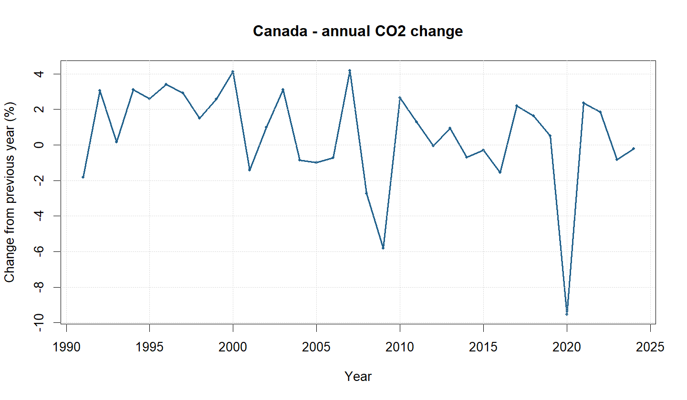

# CO2 Emissions Analysis: Canada (1990-2024)

**Student:** Rachelle A. Quebec
**Country:** Canada  
**ISO-3 Code:** CAN  
**Study Period:** 1990–2024

## 1. Research Question
How have Canada's annual CO₂ emissions and CO₂ emissions per capita changed from 1990 to 2024?

## 2. Data Source
The dataset was obtained from Our World in Data (OWID), specifically the CO₂ and Greenhouse Gas Emissions Dataset. This analysis focuses on Canada's annual CO₂ emissions and CO₂ emissions per capita from 1990 to 2024.

**Source:** https://github.com/owid/co2-data

**Dataset (CSV):** https://owid-public.owid.io/data/co2/owid-co2-data.csv

## Software Used
R and RStudio

## Methods
The dataset was processed using RStudio. Annual CO2 emissions were examined using line graphs, and year-to-year percentage changes were calculated. Summary statistics were generated to compare emissions at the beginning and end of the study period.

## Key Findings
- CO2 emissions in 1990: approximately 459.18 million tonnes.
- CO2 emissions in 2024: approximately 540.00 million tonnes.
- Overall change from 1990 to 2024: approximately 17.60% increase.
- The highest annual emissions occurred in 2007.

## Figures

### Annual CO2 Emissions

### Annual CO2 Percentage Change

### CO2 Emissions Per Capita

## Interpretation and Discussion
The analysis shows that Canada's annual CO₂ emissions increased from 459.18 million tonnes in 1990 to 540.00 million tonnes in 2024, representing an overall increase of 17.60%. The highest emissions occurred in 2007, reaching 592.03 million tonnes. Although emissions fluctuated afterward, the 2024 level remained higher than in 1990.

Total CO₂ emissions represent the country's overall contribution, while per-capita emissions show the average emissions per person. Interestingly, Canada's per-capita emissions decreased from 16.52 tonnes per person in 1990 to 13.59 tonnes in 2024, despite the increase in total emissions. This indicates that the two measurements can follow different trends.

A sustained increase in emissions was observed during the 1990s, from 459.18 million tonnes in 1990 to 567.87 million tonnes in 2000. However, a notable decrease occurred in 2020, when emissions dropped from 578.72 million tonnes in 2019 to 523.54 million tonnes, a decline of 9.53%.

One possible explanation is the COVID-19 pandemic, which reduced transportation and economic activities. Environment and Climate Change Canada (2026) reported that pandemic-related disruptions contributed to reduced national greenhouse gas emissions in 2020. However, this analysis cannot establish the exact cause of the observed CO₂ decrease.

Monitoring national emissions is important because CO₂ contributes to global warming, climate change, and ecological disturbances. However, territorial emissions data exclude emissions associated with imported goods and therefore do not represent Canada's complete consumption-based carbon footprint.

## Limitations
This analysis focuses only on Canada's CO₂ emissions from 1990 to 2024. It does not include other greenhouse gases, such as methane and nitrous oxide. The dataset uses territorial emissions and does not fully account for emissions from imported goods or land-use changes and forestry. Additionally, the analysis is descriptive and cannot determine the exact causes of changes in CO₂ emissions.

## References
Environment and Climate Change Canada. (2026). National Inventory Report 1990–2024: Greenhouse Gas Sources and Sinks in Canada. Government of Canada. https://www.canada.ca/en/environment-climate-change/services/climate-change/greenhouse-gas-emissions/inventory.html

International Energy Agency. (2022). Canada 2022: Energy Policy Review. https://www.iea.org/countries/canada

Our World in Data. (n.d.). CO₂ and Greenhouse Gas Emissions Dataset. https://github.com/owid/co2-data
