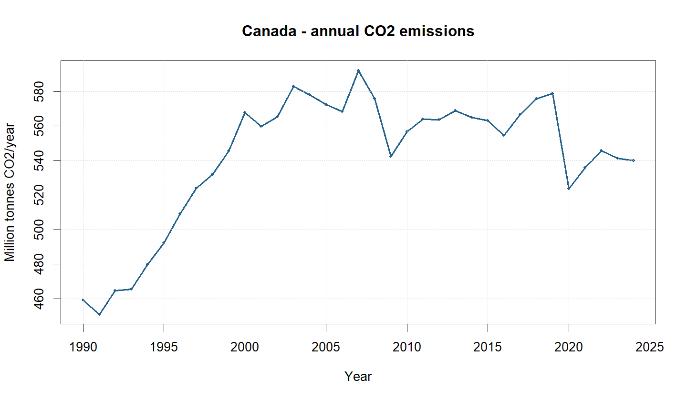
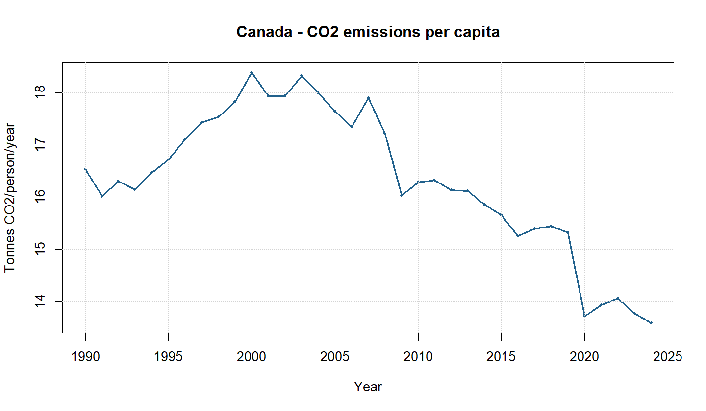

# CO2 Emissions Analysis: Canada

**Country:** Canada  
**ISO-3 Code:** CAN  
**Study Period:** 1990–2024

## Project Overview
This project analyzes Canada's annual carbon dioxide (CO2) emissions from 1990 to 2024 using RStudio and data from Our World in Data.

## Objectives
1. Examine annual CO2 emission trends in Canada.
2. Calculate changes in CO2 emissions over time.
3. Identify the year with the highest CO2 emissions.
4. Visualize annual emissions, yearly percentage changes, and per-capita emissions.

## Data Source
Our World in Data — CO2 and Greenhouse Gas Emissions dataset.

## Methods
The dataset was processed using RStudio. Annual CO2 emissions were examined using line graphs, and year-to-year percentage changes were calculated. Summary statistics were generated to compare emissions at the beginning and end of the study period.

## Key Findings
- CO2 emissions in 1990: approximately 459.18 million tonnes.
- CO2 emissions in 2024: approximately 540.00 million tonnes.
- Overall change from 1990 to 2024: approximately 17.60% increase.
- The highest annual emissions occurred in 2007.

## Figures

### Annual CO2 Emissions

### Annual CO2 Percentage Change

### CO2 Emissions Per Capita

## Repository Contents
- `data/` — CO2 dataset
- `scripts/` — R analysis code
- `figures/` — Generated graphs
- `results/` — Summary statistics and annual changes

## Software Used
R and RStudio

## Conclusion
Canada's annual CO2 emissions increased overall between 1990 and 2024, although the data show considerable fluctuations and periods of decline. The analysis illustrates how emissions have changed over time.
